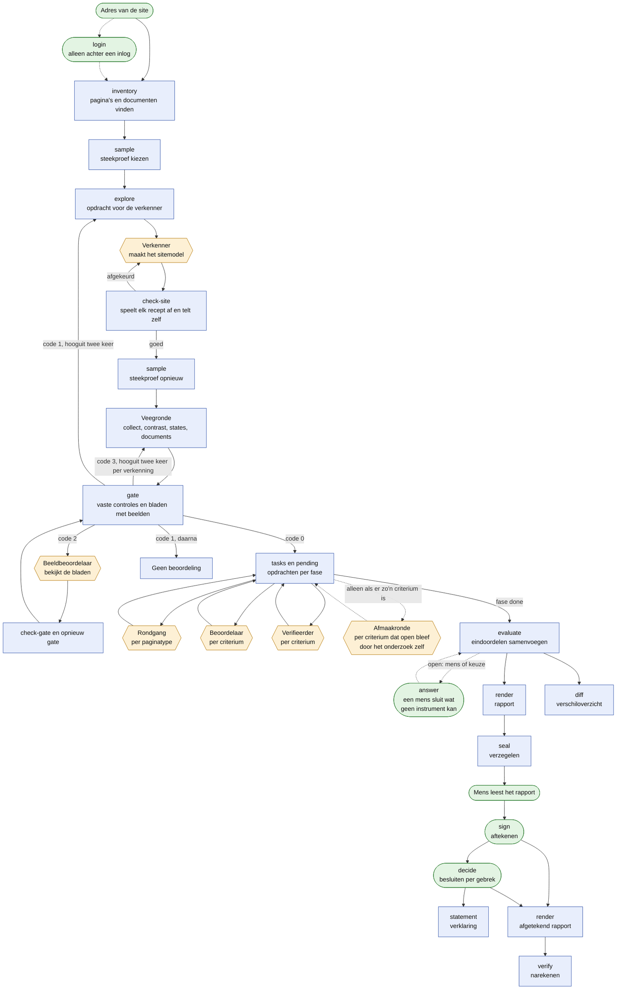
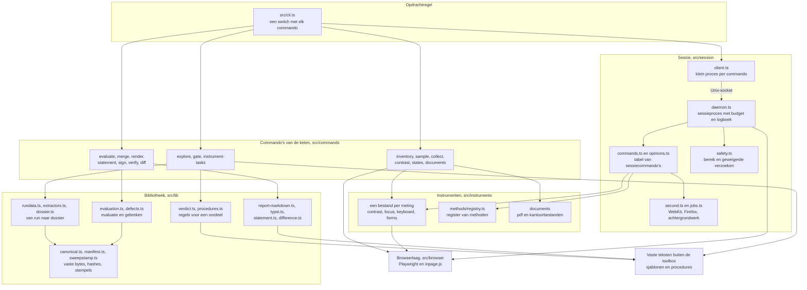
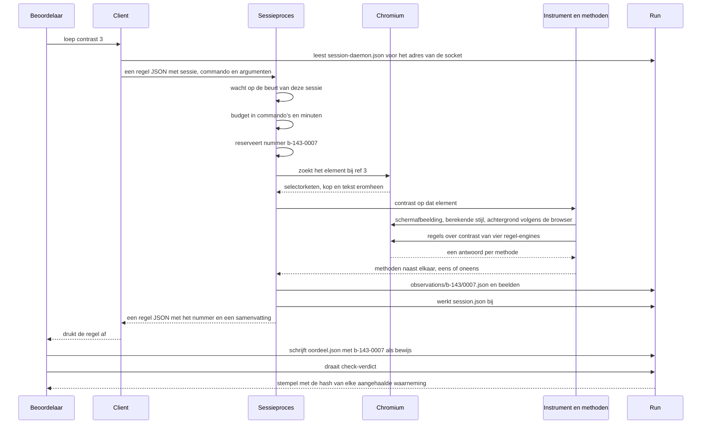

# Architectuur

Soort: beschrijving die bij de code hoort. Een wijziging in de opzet werkt haar in dezelfde commit bij.

Dit document is voor een ontwikkelaar die loep niet kent en wil weten hoe het in elkaar zit, om het te beoordelen of uit te breiden. Het beschrijft hoe de toolbox is opgezet en waar je moet zijn om iets toe te voegen. Het is geschreven vanuit de code van de commit waarin het staat. Wat een uitkomst betekent en wat de methode niet kan, staat in [methode.md](methode.md); dat wordt hier niet herhaald.

## 1. Wat loep doet

loep maakt van het adres van een website een toegankelijkheidsonderzoek op WCAG 2.2 en 2.1, niveau A en AA, met een rapport en een conceptverklaring. Het is een opdrachtregelprogramma in TypeScript dat direct met Node draait, zonder bouwstap. Het bestuurt een browser met Playwright.

Het werk is verdeeld over drie soorten uitvoerders, en die verdeling bepaalt de hele opzet.

- **Scripts meten en leggen bewijs vast.** Ze vinden de pagina's, meten elke pagina van de steekproef en schrijven alles naar bestanden in één map, de run. Een script oordeelt nergens over.
- **Agents beoordelen met instrumenten.** Een agent is een taalmodel dat één opdrachtbestand krijgt. Hij bedient de site alleen via de sessiecommando's van de toolbox. Elk commando legt een genummerde waarneming vast, en elk oordeel moet naar zulke waarnemingen wijzen. Een script controleert dat voordat het oordeel telt.
- **Een mens tekent.** `sign` legt vast wie voor de uitkomst staat. De handtekening wijst naar de hash van het zegel over de hele run en naar de hash van de evaluatie.

De toolbox roept zelf geen taalmodel aan. Hij schrijft opdrachtbestanden en controleert wat terugkomt. Wie de agents start, is een zaak van de omgeving eromheen: de skill `nldd-a11y-audit` doet het stap voor stap, en de werkstroom `skills/nldd-a11y-audit/onderzoek.workflow.js` doet het in een lus.

Wat loep uitdrukkelijk niet is:

- Geen regel-engine. axe-core en Alfa draaien mee als bewijs, maar hun uitkomst is geen oordeel.
- Geen dienst en geen server. Alles draait op de machine van wie het onderzoek uitvoert, en de uitvoer is een map met bestanden.
- Geen vervanging van een onderzoek met echte hulpsoftware. Een echte schermlezer draait alleen als iemand de optionele virtuele Mac met VoiceOver heeft ingericht en gestart; NVDA en JAWS draaien niet.
- Geen programma dat zelf inlogt of iets publiceert. Voor een site achter een inlog logt een mens in en neemt loep de sessie over. Ook het register vult het niet in.

## 2. De keten

In het schema is een rechthoek een script, een zeshoek een agent en een afgeronde vorm een mens.



Elke stap leest bestanden uit de run en schrijft er nieuwe bij. De namen hieronder zijn paden binnen de run.

**Inventaris** (`inventory`, `toolbox/src/commands/inventory.ts`). Erin gaat een adres. Het script volgt de links, ook door shadow DOM, telt per pagina wat erop staat en bewaart een kopie. Eruit komen `inventory.json` en per pagina `pages/<slug>/page.html`. Hier wordt ook voor de hele run vastgelegd of er iets verstuurd mag worden; dat staat in `manifest.json`.

**Inlog** (`login`, `toolbox/src/commands/login.ts`), alleen voor een site achter een inlog en vóór de inventaris. Een mens logt in een zichtbaar browservenster in; het commando bewaart de sessie (de `storageState` van Playwright) in `login-session.json` en zet in het manifest wat erover gezegd mag worden: de rol, de inlogpagina en de pagina die de mens aanwees. Alles wat met de sessie gebeurt, staat in `toolbox/src/lib/login.ts`. Buiten het inloggen zelf (`login.ts`, met een zichtbaar venster) is `newContext` in `toolbox/src/browser/session.ts` de enige plek waar een browsercontext ontstaat, en geeft elke context de sessie mee als de run er een heeft; een run zonder sessiebestand krijgt wat hij altijd kreeg. `loadPage` in hetzelfde bestand kijkt na elke lading of de pagina op het inlogscherm lijkt en gooit dan een `LoginExpired`; dat blijft gelden tot het sessiebestand is vernieuwd, zodat een verlopen sessie niet pagina na pagina opnieuw wordt geprobeerd. Een verzoek dat uitlogt, wordt tegengehouden waar verzoeken de browser verlaten: in `newContext` en in `guardContext` van de sessies. De regels voor "verlopen" en "uitloggen" staan in [methode.md](methode.md).

**Sessieproef** (`watch-session`, `toolbox/src/commands/watch-session.ts`), alleen in een run met een inlog, voor 2.2.1. De meting houdt haar eigen sessie bezig, dus een mens logt een tweede keer in met `login --idle`; die sessie staat in `idle-session.json` en alleen dit proces leest haar. Het proces volgt het patroon van het sessieproces: `collect` start het los op de achtergrond (`startSessionWatch`), de stand staat in `session-watch.json` in de run met het proces-id erin, en een tweede start op dezelfde run laat een lopend proces staan. Het houdt één tabblad met de tweede sessie open dat het met rust laat, kijkt daar om de halve minuut naar een waarschuwing, en kijkt met oplopende tussenpozen in een verse context met de cookies van de tweede inlog of de sessie nog leeft (`landingFellBack` in `toolbox/src/lib/login.ts`). Het stopt zelf als de sessie verliep of na een grens (`--max-hours`, standaard 8); `evaluate` stopt het met `stopSessionWatch`, legt de stand vast en sluit met `sessionWatchAnswers` (`toolbox/src/lib/timelimits.ts`) het open punt over de sessieduur als de sessie niet verliep. Zo'n uitkomst krijgt `established.by: "sessionWatch"`. Het dossier toont de proef onder `timing.session`; zolang ze loopt alleen dat ze loopt, zodat het dossier en daarmee het stempel van een oordeel niet bij elke controle verandert. Verloopt de tweede sessie of bereikt de proef haar grens terwijl de agents werken, dan verandert het dossier van 2.2.1 één keer, en de volgende `tasks` zet dat criterium opnieuw uit.

**Steekproef** (`sample`). Tot en met zestig unieke pagina's is de steekproef de hele site; daarboven kiest een seed die `inventory` bij de start van de run willekeurig maakt en in `manifest.json` zet (met `--seed` kies je hem zelf). Met een sitemodel krijgt elk paginatype zijn voorbeeldpagina, en een groot type extra pagina's die vast worden gekozen op variatie in inhoud, uit de tellingen van de inventaris (zie de methode). Documenten krijgen een eigen label. Eruit komt `sample.json`. Het label `P01` is de eerste pagina daarin en `D01` het eerste document; die labels keren in elk later bestand terug.

**Verkenner en sitemodel** (`explore`, daarna een agent). `explore` schrijft `explore/verken.md` uit het sjabloon `templates/verken.md`, gevuld met wat de inventaris vond. De verkenner schrijft `site.json`: paginatypen, wat over de pagina ligt, onderdelen die pas na een handeling iets tonen, processen en ingesloten vensters. Elke toestand is een recept in `recipes/<naam>.json`, bewaard met het sessiecommando `state save`, met een voorwaarde die een script kan narekenen.

**Controle van het sitemodel** (`check-site`, `toolbox/src/commands/explore.ts`). Het script toetst de vorm van `site.json`, speelt elk recept af vanaf een verse pagina, probeert elk onderdeel op de voorbeeldpagina van elk paginatype in zijn `pageTypes` in het venster van de veegronde (een onderdeel met `"pageTypes": "all"`, dat op elke pagina staat, op drie paginatypen verspreid over de lijst; de veegronde opent het op alle) (dezelfde functie als de veegronde gebruikt, `toolbox/src/commands/modelsweep.ts`), en telt zelf, breed en smal, wat er op elk paginatype te bedienen is. De uitkomst staat in `site-check.json` en de telling in `explore/operables.json`. Daarna trekt `sample` de steekproef opnieuw, omdat het sitemodel zegt welke adressen een venster van een derde zijn.

**Veegronde** (vier commando's, geen taalmodel). `collect` schrijft per pagina `pages/<slug>/` met de uitkomsten van axe-core en Alfa in licht en donker, wat een tijdslimiet kan zijn (`toolbox/src/instruments/timelimits.ts`: elke timer met wat hij deed, ook als loep hem aan het eind zelf liet afgaan, meta refresh, cookies en opslag), de feiten uit de toegankelijkheidsboom, de wandeling met Tab, de proeven op afmeting, de volgorde van code en scherm, de taal van tekstalternatieven, de tekst in elke afbeelding (`toolbox/src/instruments/pictures.ts`) en de bediening die alleen tussen de gemeten breedtes verschijnt (`toolbox/src/instruments/widths.ts`); daarna opent het elke toestand uit het sitemodel en meet daar opnieuw (`site-states/<toestand>/` en `site-states.json`). `contrast` schrijft `contrast.json`, ook met de kleuren van elke link en knop bij aanwijzen en focus, `states` schrijft `states.json` (dialogen, formulieren, toetsen, aanwijzen) en `documents` schrijft per document `documents/<slug>/facts.json`. Elke meting laat een stempel achter; een tweede veegronde meet alleen wat daartegen niet meer geldig is. Met `--at-once` meten de drie eerste commando's meer tegelijk (`toolbox/src/lib/atonce.ts`): de functie inOrder voert het werk uit met een vast maximum en geeft de uitkomsten in de volgorde van de pagina's door, ModelSweep.fork geeft elke pagina, ronde of groep een eigen bewaker en eigen notities die ModelSweep.absorb daarna in die volgorde overneemt, en spaceNavigations in `toolbox/src/browser/session.ts` houdt tussen twee navigaties naar dezelfde host de tijd van het sessieproces aan.

**Poort** (`gate`, `toolbox/src/commands/gate.ts`). Eerst vaste controles op de getallen van de veegronde, zoals het aandeel bedieningselementen dat met Tab is bereikt en het aandeel onderdelen dat openging. Dan maakt het script per paginatype één blad met beelden (`gate/sheet-<type>.png`) en de opdracht `gate/poort.md`; bij meer dan acht paginatypen komen er opdrachten `gate/poort-<n>.md` bij, met antwoorden in `gate/answers-<n>.json`. Elk antwoord noemt per blad het kenmerk van dat blad (`reviewedAs`); antwoorden die na nieuwe bladen niet meer kloppen, zet `gate` opzij in `gate/vorige/`. De afsluitcode stuurt het vervolg: 0 is voldoende, 2 betekent dat de beelden nog bekeken moeten worden, 3 dat een nieuwe veegronde de gaten sluit, 1 is onvoldoende. Elk gat zegt in `fixedBy` wie het kan sluiten: de veegronde als een meting mislukte, op een tijdgrens stuitte of ontbreekt, anders de verkenner. Een stap van een recept die mislukt (een reden die begint met "stap <n> (") of een toestand die de verkenner niet kon openen, is altijd van de verkenner, ook als de fout van de browser een tijdgrens noemt. Zolang er een gat voor de veegronde is, geeft de poort code 3; dat kost geen terugkeer naar de verkenner. Na de verkenning mag dat twee keer (`MAX_RESWEEPS`, geteld als `collect` na de laatste `explore`, ook `collect --only`); daarna gaat zo'n gat naar de verkenner. Zijn er alleen gaten voor de verkenner, dan komen eerst de beelden (code 2), zodat de verkenner de gaten van de vaste controles en van de beelden in één keer krijgt. Na een onvoldoende schrijft `explore` een vervolgopdracht met de gaten voor de verkenner erin. Dat mag twee keer (`MAX_RETURNS_TO_EXPLORER`); daarna komt er geen beoordeling. De uitkomst staat in `gate.json`, met in het veld next wat er volgt.

**Rondgangen, beoordelaars en verifieerders** (`tasks` en `pending`, `toolbox/src/commands/instrument-tasks.ts`). `tasks` schrijft de opdrachtbestanden van de fase waarin de run is, en `pending` zegt als JSON welke fase dat is en wat nog open staat. Eerst loopt per paginatype een agent één pagina door en schrijft kandidaten (`rondgang/<type>.json`). Het script verdeelt die kandidaten over de criteria. Dan beoordeelt per criterium een agent het dossier (`tasks/<criterium>/dossier.json`) en schrijft `verdicts/<criterium>/oordeel.json`. Pas als elke beoordeling binnen of overgeslagen is, schrijft `tasks` de opdrachten voor de verifieerders; die schrijven `verdicts/<criterium>/final.json`. Elke agent draait zelf de controle op zijn uitvoer (`check-walk`, `check-verdict`). Slaagt die, dan komt er een stempelbestand naast de uitvoer.

**Afmaakronde** (dezelfde twee commando's, vierde fase). Zijn alle verifieerders binnen of overgeslagen, dan kijkt `tasks` welke criteria open bleven door het onderzoek zelf: het eindoordeel is "kan niet bepalen" met een open punt van de soort `veegronde mist`, `budget op`, `proef werkte niet` of `niet bereikbaar`, of er kwam na twee pogingen geen geldig oordeel (`pointsToFinish`). Voor elk daarvan schrijft het `tasks/<criterium>/afmaak.md` uit het sjabloon `templates/afmaak.md`, met de open punten letterlijk en genummerd erin, en `kandidaten-afmaak.json` met de kandidaten waarover nog niemand met een eigen waarneming heeft beslist. `pending` meldt dan `phase: "finishers"`. De agent schrijft `verdicts/<criterium>/afmaak.json`; de controle is `check-verdict --round finish` (`validateFinish` in `toolbox/src/lib/verdict.ts`). Het stempel van dat oordeel noemt de hash van de oordelen waar het op voortbouwt: verandert het eindoordeel van de verifieerder, dan geldt het afmaakoordeel niet meer. Is er geen zo'n criterium, dan schrijft `tasks` niets en gaat `pending` van `phase: "verifiers"` naar `phase: "done"`. `tasks --again <criteria>` zet voor een criterium waarvan het eindoordeel open staat met `niet bereikbaar` of `proef werkte niet` een nieuwe afmaakronde klaar, ook na `phase: "done"`: het zet het vorige oordeel met zijn stempel en opdracht apart onder een nummer (`afmaak-1.json`, `afmaak-1.md`), noemt het in de index onder `finish.earlier`, en schrijft een nieuwe opdracht met de open punten van dat oordeel en een nieuwe sessienaam. `evaluate` neemt het nieuwe oordeel en toont het vorige als wat hiervoor stond. Waarom er na deze ronde geen verifieerder komt, staat in [methode.md](methode.md).

**Antwoord van een persoon** (`answer`, `toolbox/src/commands/answer.ts`). Voor een open punt dat geen instrument kan sluiten. Zonder `--point` toont het de open punten van een criterium; met een punt, een antwoord, een uitkomst, een naam en een functie schrijft het `antwoorden/<criterium>.json`. Het antwoord noemt de hash van het oordeel waar het bij hoort en telt alleen daarbij. De naam blijft in dat bestand; `evaluate` neemt alleen de functie over. Elk antwoord zegt hoe het tot stand kwam (`recordedVia`): "terminal", de persoon bevestigde het in een interactieve terminal, of "gesprek", de agent legde het vast na een uitdrukkelijke bevestiging, met die bevestiging letterlijk (`confirmationNl`) en de bevestigde samenvatting (`summaryNl`) erbij. Zonder een van beide weigert het commando (`recordStatement` in `toolbox/src/lib/recorded.ts`; zie "Wie vastlegt" in [methode.md](methode.md)).

**Evaluatie** (`evaluate`). Het script neemt per criterium het eindoordeel van de verifieerder, of dat van de afmaakronde als die er was, en alleen als het stempel nog klopt met het dossier, de procedure, de opdracht en de aangehaalde waarnemingen (`gatherVerdicts`). Daarna tellen de antwoorden van een persoon op de open punten van dat oordeel mee (`applyAnswers` in `toolbox/src/lib/evaluation.ts`). Per criterium staat in de evaluatie door wie of wat de uitkomst is vastgesteld (`established.by`: de verificatie, de afmaakronde, een persoon of, bij 2.2.1, de sessieproef) en wat het oordeel ervoor was. Het script meldt hoeveel criteria open zijn, in drie groepen: wat een mens of een keuze vraagt, wat alleen open is omdat de run niet mocht versturen (`versturen niet toegestaan`, te sluiten met een testomgeving bij `inventory`), en wat het onderzoek zelf niet vaststelde. Alleen bij dat laatste waarschuwt het. Bevindingen over dezelfde plek worden één gebrek. Aanbevelingen uit het oordeel gaan met een eigen nummer mee, los van de uitkomst. Eruit komt `evaluation.json`: het enige bestand waar rapport en verklaring uit worden gemaakt.

**Rapport** (`render`). Uit `evaluation.json` komen `report/rapport.md`, `report/rapport.pdf` en `report/rapport-kort.pdf`. Is de run afgetekend, dan schrijft `render` dezelfde drie bestanden in `signed/`, met de functie van wie tekende (de naam staat alleen in `signed/signature.json`); het concept in `report/` blijft staan. De pdf wordt met Typst gemaakt als PDF/UA-1 en daarna zelf gecontroleerd. Emoji in tekst van de site staan in de pdf in Noto Emoji. Een teken dat geen meegeleverd lettertype heeft, zoals Chinees schrift, staat in de pdf als codepunt (`[U+4E2D]`); `rapport.md` houdt de tekst zoals hij is.

**Verschiloverzicht** (`diff`). Twee evaluaties van dezelfde site naast elkaar: opgelost, gebleven en nieuw, gekoppeld op criterium, pagina en plek. Het schrijft `verschil.md` in een map naar keuze. Het is een werkdocument en geen deel van het rapport.

**Besluiten** (`decide`, `toolbox/src/commands/decide.ts`). Na het tekenen, per gebrek: opgelost, gepland met een datum, een andere zienswijze, onevenredige last of nog niet besloten, met wat, de datum, naam en functie, en hoe het besluit tot stand kwam (in een terminal, of in een gesprek met de letterlijke bevestiging en de samenvatting). Het schrijft `besluiten/<gebrek>.json`, met het vorige besluit erin bewaard, en zet de hash van dat bestand in `besluiten/index.json` (`toolbox/src/lib/decisions.ts`). De map staat buiten het zegel, als eigen laag met een eigen hash, zoals de handtekening. `render` zet de besluiten in het afgetekende rapport, `statement` neemt er de maatregelen uit, en `verify` rekent de laag na tegen de index en tegen de gebreken van de evaluatie.

**Verklaring** (`statement`). Schrijft `verklaring/verklaring.md`, `verklaring/invulassistent.md`, `verklaring/verklaring.json` en de pdf's. Zonder geldige handtekening kan alleen een concept (`--concept`).

**Verzegelen en aftekenen** (`seal`, `sign`, `verify`), in die volgorde. `seal` schrijft `evidence-index.json` met de sha256 van elk bestand in de run, ook van de evaluatie, het conceptrapport en de antwoorden van een persoon. `sign` weigert een evaluatie met een criterium zonder oordeel, een run zonder zegel en een run die na het verzegelen is veranderd, en zonder een interactieve terminal waarin de ondertekenaar de eerste acht tekens van het zegel intypt. Het schrijft de handtekening naar `signed/signature.json`, met de hash van het zegel en van de evaluatie. `verify` rekent elke hash na en meldt wat is gewijzigd, toegevoegd of verdwenen, en een handtekening die bij een ander zegel of een andere evaluatie hoort.

De sessiebestanden van een inlog (`login-session.json` en `idle-session.json`) slaan het zegel helemaal over: het is een geheim en geen bewijs, en het weggooien ervan breekt het zegel niet. De werkmappen van de agents (`werk/<sessie>/`) vallen er wel onder: een hulpscript laat zien hoe een agent de toolbox aanriep, en dus hoe zijn waarnemingen tot stand kwamen. Verder staat buiten het zegel alleen wat na het tekenen wordt gemaakt: `signed/` (de handtekening en het afgetekende rapport), `besluiten/`, `verklaring/` en `verklaring-invoer.json` (`OUTSIDE_SEAL` in `toolbox/src/commands/verify.ts`). Daardoor breekt tekenen het zegel niet, en ook `decide`, `render` en `statement` daarna niet. Wordt een afgetekende run na een wijziging opnieuw verzegeld, dan verwijdert `seal` de map `signed/`: de handtekening hoorde bij het vorige zegel.

## 3. Wie wat mag

Een agent krijgt alleen zijn opdrachtbestand en begint met een schone context. De vaste budgetten staan als constanten in de code (`BUDGETS` in `toolbox/src/commands/instrument-tasks.ts`, `EXPLORE_MAX_COMMANDS` in `toolbox/src/commands/explore.ts`). Voor een rondgang, een beoordelaar, een verifieerder en de afmaakronde is dat de ondergrens: `tasks` rekent per opdracht uit wat erbij komt (`toolbox/src/lib/budget.ts`: het gemeten verbruik per criterium, de omvang van de site, het aantal kandidaten), tot een bovengrens per rol, en vult de uitkomst in de opdracht in. De sessie dwingt het budget af: is het op, dan weigert ze elk commando dat iets kost. Een agent kan zijn sessie twee keer verlengen met `session extend`, elke keer met de helft van waarmee hij begon; de formule en de regels staan in [methode.md](methode.md#het-budget-van-een-agent).

| Rol | Leest | Schrijft | Budget | Controle die de uitvoer afkeurt |
|---|---|---|---|---|
| Verkenner | `explore/verken.md` en `explore/context.json`; de site via zijn sessie `verken` | `site.json` en recepten in `recipes/` | 200 commando's, 40 minuten; een vervolgronde krijgt een nieuwe sessie | `check-site`: de vorm klopt niet, een recept loopt niet of zijn voorwaarde geldt daarna niet, de eigen telling vindt een formulier of bedieningsonderdeel dat het model mist, of de voorbeeldpagina van een paginatype is een ander adres van een pagina van de steekproef |
| Beeldbeoordelaar van de poort | `gate/poort.md` en de bladen `gate/sheet-<type>.png`; hij bezoekt de site niet | `gate/answers.json` | geen sessie en dus geen budget in commando's; hooguit acht bladen per opdracht | `check-gate`: een blad of een vaste vraag zonder antwoord, een antwoord buiten ja, nee en onduidelijk, een antwoord dat op een probleem wijst zonder toelichting, of een antwoord waarvan `reviewedAs` niet bij het huidige blad hoort |
| Rondgang | `rondgang/<type>.md`; de site via een sessie `r-<type>` | `rondgang/<type>.json` met kandidaten | 110 commando's, 40 minuten als ondergrens; hooguit 220 en 80 | `check-walk`: een kandidaat zonder waarneming van een kijk- of meetcommando, een waarneming die niet bestaat, een criterium zonder procedure, een pagina buiten de legenda |
| Beoordelaar | `tasks/<criterium>/beoordeel.md` met de procedure erin, het dossier, `kandidaten.json`, `gate.json`; de site via een sessie `b-<nummer>` | `verdicts/<criterium>/oordeel.json` | 80 commando's, 30 minuten als ondergrens; hooguit 240 en 90 | `check-verdict --round judge`: zie onder de tabel |
| Verifieerder | `tasks/<criterium>/verifieer.md`, het oordeel van de beoordelaar, het dossier, `kandidaten-verificatie.json`; de site via een sessie `v-<nummer>` | `verdicts/<criterium>/final.json` | 20 commando's, plus 5 per bevinding, 3 per weggezette kandidaat en 30 als de beoordelaar niet afkeurde; 30 minuten. Dat is de ondergrens; hooguit 240 en 90 | `check-verdict --round final`: zie onder de tabel |
| Afmaakagent | `tasks/<criterium>/afmaak.md` met de open punten en de procedure erin, de oordelen tot nu toe, het dossier, `kandidaten-afmaak.json`; de site via een sessie `a-<nummer>` | `verdicts/<criterium>/afmaak.json` | 280 commando's, 105 minuten: dat van een beoordelaar maal 3,5 (`FINISH_FACTOR`), als ondergrens; hooguit 420 en 158 | `check-verdict --round finish`: zie onder de tabel |

Elke agent met een sessie krijgt ook een eigen werkmap, `werk/<sessie>/`, die het commando dat de opdracht schrijft (`explore` of `tasks`) aanmaakt. De agents van de poort en van het samenvoegen hebben geen sessie en krijgen `werk/poort-<n>/` en `werk/samenvoeg/`. Hulpbestanden en hulpscripts horen daar en nergens anders. Laat een worktree een agent niet in de map van de run schrijven, dan maakt hij een map met dezelfde naam in de map waar hij wel mag schrijven, zoals `<scratchpad>/<sessie>/`, en zet hij nooit een bestand met een algemene naam in een gedeelde map. Die regel staat één keer in `templates/werkmap.md`; `readTemplate` in `toolbox/src/lib/templates.ts` zet hem in elke opdracht, voordat de opdracht wordt ingevuld, zodat de hash van de opdracht hem dekt. Agents werken tegelijk in één run; twee agents schreven eens een hulpscript met dezelfde naam op een gedeelde plek, elk met zijn eigen sessie erin, en daarna mat de een onder de sessie van de ander. De sessie kan dat zelf niet zien: een agent heeft geen kenmerk dat de sessie kan controleren, en een sleutel per sessie zou in hetzelfde gedeelde script belanden.

Wat `check-verdict` weigert, staat in `toolbox/src/lib/verdict.ts`; de regels over `budget op` (`budgetPointProblems`) en `versturen niet toegestaan` (`notSentPointProblems`) worden in `toolbox/src/commands/instrument-tasks.ts` toegepast, omdat ze de sessie en de toestemming van de run nodig hebben. De belangrijkste regels:

- Een bevinding zonder waarneming van een kijk- of meetcommando die is geslaagd, in een toestand die met `open` begint. Voor de verifieerder tellen alleen waarnemingen uit zijn eigen sessie.
- Een goedkeuring zonder eigen waarneming, of zonder een waarneming van elk commando dat de procedure onder `pass_observations` noemt.
- Een goedkeuring die leunt op een meting waarvan de methoden het oneens zijn over dit criterium, zonder een tweede waarneming die het verschil beslecht.
- Een aangehaalde tekst die niet letterlijk in een aangehaalde waarneming, een deel van het dossier of de bewaarde kopie van de pagina staat.
- Een kandidaat zonder uitspraak, of een kandidaat die wordt weggezet zonder dat ernaar is gekeken.
- Een open punt `budget op` van een sessie die haar budget niet twee keer heeft verlengd.
- Een aanbeveling zonder regel uit de sectie "Aanbevelingen" van de procedure, zonder waarneming die haar toont, of op een plek waar het oordeel een bevinding heeft; bij de verifieerder ook een aanbeveling op de plek van een bevinding van de beoordelaar die als `notReproduced` of `wrongCriterion` is vervallen.
- Een open punt `versturen niet toegestaan` over de origin waar de run naar mag versturen: daar verstuurt en meet de agent zelf. Alleen als het budget voor versturen van de run op is, mag het punt er staan, en dan zegt het dat.
- Een plek die alleen een selector is, een open punt zonder soort, en een hersteladvies over de binnenkant van een component van de leverancier dat de leverancier niet als eigenaar noemt.
- Bij de verifieerder: een bevinding van de beoordelaar die niet is bevestigd en ook niet met een reden is vervallen, een eindoordeel dat van een afkeuring een goedkeuring maakt, en na een afkeuring een eindoordeel "kan niet bepalen" waarin een bevinding is vervallen omdat de norm haar niet dekt en dat meer punten `keuze nodig` heeft dan de beoordelaar had.
- Bij de afmaakagent: een open punt `veegronde mist` of `budget op`; een punt `proef werkte niet` of `niet bereikbaar` zonder beschreven poging met twee eigen waarnemingen; een open punt uit de opdracht zonder regel; een goedkeuring die een punt open laat; en een bevinding die niet twee keer is vastgelegd, de tweede keer na een nieuwe `open`.

Een mens heeft geen rol in deze tabel en toch vier handelingen die van hem zijn: een open punt beantwoorden met `answer`, besluiten per gebrek met `decide`, tekenen met `sign`, en verklaren dat een site een testomgeving is. Een antwoord en een besluit mag de agent die het onderzoek leidt vastleggen, met `--recorded-via gesprek` en de letterlijke bevestiging en samenvatting erbij. Tekenen en de verklaring voor versturen vragen een interactieve terminal waarin de persoon het begin van het zegel of de origin intypt (`confirmByTyping` in `toolbox/src/lib/recorded.ts`, `confirmDeclaration` in `toolbox/src/lib/writes.ts`); zonder weigeren ze. De commando's krijgen de terminal als argument, zodat een test de persoon kan spelen; vanaf de opdrachtregel is het altijd de standaardinvoer van het proces. Inloggen doet de persoon altijd zelf.

Mislukt een agent twee keer, dan legt `skip` vast dat het resultaat niet komt. Na een beoordelaar of verifieerder die niets leverde, krijgt het criterium een afmaakronde; mislukt ook die, dan blijft het "niet beoordeeld" of open, en zegt het rapport dat het onderzoek niet af is.

## 4. De lagen in de code

De paden in het schema zijn mappen onder `toolbox/`, tenzij er iets anders staat.



**Opdrachtregel.** `toolbox/src/cli.ts` is één bestand: een gebruikstekst en een `switch` met een tak per commando. Elke tak laadt zijn module pas als hij nodig is. Een paar commando's ontleden hun argumenten zelf en worden vóór de `switch` afgehandeld: `session`, `calibrate`, `variant`, `compare-variants` en `usage`, en `compare` met `--findings`.

**Commando's** (`toolbox/src/commands/`). De meeste bestanden zijn een stap van de keten. Daarnaast staan hulpcommando's: `gaps` en `feedback` lezen een afgeronde run (`feedback` schrijft een tekst voor een issue voor elk criterium dat open bleef door loep zelf, en voor een criterium met een oordeel waarbij een proef niet werkte; het verstuurt niets), `estimate` schat de duur, `compare` en `compare-findings` vergelijken met een bestaand onderzoek, `calibrate` ijkt de instrumenten, `variant` en `compare-variants` meten een variant van de code op een bevroren veegronde, met `usage` voor de tokens per agent uit de transcripts (zie [validatie/verbruik/README.md](../validatie/verbruik/README.md)), en `voiceover` beheert de virtuele Mac. `modelsweep.ts` hoort bij de veegronde: het sluit wat over een pagina ligt en opent de toestanden uit het sitemodel. `instrument-tasks.ts` bevat de vier fasen met agents (rondgang, beoordelaar, verifieerder, afmaakronde), de stempels en de controles `check-walk` en `check-verdict`.

**Sessie** (`toolbox/src/session/`). Een sessie is de browser van één agent. Het sessieproces (`daemon.ts`) houdt één Chromium vast met per sessie een eigen browsercontext, telt het budget en schrijft het logboek van waarnemingen (`observations.ts`). De cliënt (`client.ts`) is een klein proces per commando dat alleen een verzoek over een Unix-socket stuurt. `commands.ts` is de tabel van sessiecommando's; `opinions.ts` zet er de methoden naast die dezelfde vraag beantwoorden. `safety.ts` bewaakt het bereik: alleen GET en HEAD, niets buiten de hosts van de run, niets over een WebSocket, tenzij de run een testomgeving heeft. Ook dan neemt elk verzoek dat iets kan wijzigen er één uit het budget voor versturen van de run (`WriteAccess.claim` in `toolbox/src/lib/writes.ts`): het telt de regels in `writes.jsonl`, onder een slot op schijf omdat de veegronde in eigen processen verstuurt, en weigert een verzoek als het budget op is of de vorige verzending te kort geleden was. Op een verklaarde testomgeving is de laatste helft van het budget voor wie nog niets verstuurde (`reservedWrites`): het logboek noemt per verzending de sessie of het commando, en de sessies van één criterium (`b-331`, `v-331`, `a-331`) tellen als één verzender (`senderOf`). Een frame over een websocket telt alleen als er een vaste testwaarde in staat (`isOurMessage`, met `MESSAGE_VALUES` naast `TEST_VALUES`); een hartslag gaat door zonder te tellen. De veegronde (`newContext` in `toolbox/src/browser/session.ts`) gebruikt dezelfde telling. Een leesverzoek uit een goedgekeurd sitemodel (`toolbox/src/lib/reads.ts`) gaat ook door, in de sessie en in de veegronde, maar alleen als de body een zoekvraag is aan de dienst van de regel; welke vorm dat per dienst is, staat in `toolbox/src/lib/searchbody.ts`. De controle van Cloudflare tegen robots gaat ook door (`toolbox/src/lib/challenge.ts`): alles naar `challenges.cloudflare.com` en zijn subdomeinen, en een pad onder `/cdn-cgi/challenge-platform/` op een host die in die browsercontext al met de kop `cf-ray` antwoordde (`answeredByCloudflare` in `toolbox/src/browser/session.ts`). `second.ts` start WebKit en Firefox de eerste keer dat een methode erom vraagt; `jobs.ts` laat trage methoden op de achtergrond lopen. `recipe.ts` speelt recepten af buiten een sessie, voor de veegronde en `check-site`. `voiceover-command.ts` laat VoiceOver in de virtuele Mac de toestand van een sessie voorlezen: het haalt de pagina één keer op, maakt er met `toolbox/src/lib/voiceover-page.ts` een proefpagina van die de stappen in Safari naspeelt en niets verstuurt, en wacht in de wachtrij van de ene virtuele Mac (`GuestQueue` in `toolbox/src/lib/voiceover.ts`, met een slot op schijf tegen een ander proces).

**Instrumenten** (`toolbox/src/instruments/`). Een instrument is een functie die op een pagina iets meet en gegevens teruggeeft. De veegronde en de sessie gebruiken dezelfde instrumenten. `methods/registry.ts` is het register van methoden: per methode een korte naam, de vraag die ze beantwoordt, het principe waarop ze werkt, waar haar versie vandaan komt en haar licentie. `methods.ts` beschrijft de vorm van een meting met meer methoden (`Measured`).

**Browserlaag** (`toolbox/src/browser/`). Hier start Chromium en staan de vaste omstandigheden waaronder een pagina wordt getekend (`RENDERING` in `session.ts`); ze komen in het manifest, zodat twee runs op dezelfde commit dezelfde pagina zien. `inpage.js` is een hulpbibliotheek die in elke pagina wordt geladen en alleen leest: elementen vinden door shadow DOM heen, tekst en maten opvragen. Ze draait twee keer: in de pagina, waar ze telt wat de pagina registreert en de lijst van elementen bijhoudt, en in een eigen omgeving van de browser (`world.ts`), waar ze meet met ingebouwde functies waar geen script van de pagina bij kan. Daar draaien ook de regelsets. `frame.ts` behandelt ingesloten vensters en `clipboard.ts` legt vast wat een pagina naar het klembord schrijft.

**Bibliotheek** (`toolbox/src/lib/`). Gedeelde code die meer commando's gebruiken. Het grootste deel leest en schrijft alleen bestanden en is zonder browser te testen. `rundata.ts` leest een run in, `extractors.ts` maakt per onderdeel van het bewijs een uittreksel en `dossier.ts` stelt daaruit het dossier van één criterium samen. `verdict.ts` bevat elke regel waaraan een oordeel moet voldoen. `evaluation.ts` is de enige plek waar een criterium zijn uitkomst krijgt (`resolveCriterion`) en waar de status wordt berekend. `report-markdown.ts` levert het rapport als Markdown en alles wat het Typst-sjabloon nodig heeft; `difference.ts` koppelt bevindingen van twee evaluaties.

**Sjablonen en procedures** (`templates/` en `procedures/`, buiten de toolbox). De sjablonen zijn de vaste opdrachten aan de agents en de opmaak van rapport en verklaring. `templates/gereedschap.md` wordt ingevoegd in de opdrachten van rondgang, beoordelaar, verifieerder en afmaakronde; `templates/bevinding.md` in die van beoordelaar, verifieerder en afmaakronde. `templates/werkmap.md`, waar hulpbestanden horen, komt in elke opdracht met een werkmap: ook in die van verkenner, poort en samenvoegen. De procedures zijn één bestand per succescriterium; zie [procedures/README.md](../procedures/README.md).

## 5. Een sessiecommando van begin tot eind

Op de opdrachtregel is een sessiecommando `session <commando>`: via de `bin` van het pakket dus `loep session open P01`, `loep session look` en `loep session contrast 3`, naast `session start`, `session stop`, `session list` en `session extend`. Geen sessiecommando heet zoals een van die vier; een test bewaakt dat. Een agent typt korter. Zijn opdracht geeft hem een shellfunctie die `session`, de run en zijn sessienaam invult, zodat hij `loep contrast 3` schrijft. Zo staan de commando's ook in de procedures.



In woorden, met de plek in de code:

1. **De cliënt** (`sessionCli` in `toolbox/src/session/client.ts`). `cli.ts` ziet `session` en geeft de argumenten door. De cliënt leest in de run `session-daemon.json`, waar het pad van de socket staat, en stuurt één regel JSON. Hij laadt de code van de commando's niet: een wijziging in die code terwijl een sessie loopt, breekt de sessie dan niet. Eén commando gaat niet naar het sessieproces: `dossier` leest het dossier zelf uit de run (`toolbox/src/session/dossier-command.ts`, met de compacte vorm en de delen in `toolbox/src/lib/dossier-view.ts`). Het heeft geen browser nodig, geeft geen waarneming en kost niets van het budget. Wat het toonde, schrijft het naar `observations/<sessie>/dossier-reads.jsonl`; `check-verdict` leest dat bij een goedkeuring.
2. **Het sessieproces** (`Daemon.command` in `toolbox/src/session/daemon.ts`). Commando's van één sessie lopen na elkaar; andere sessies gaan door. Het proces weigert een onbekend commando, kijkt of het budget nog ruimte heeft en reserveert het volgende nummer. Vanaf 80 procent van de commando's of de minuten staat in elk antwoord één regel `budget`: wat er over is en hoe de agent verlengt. `session extend` is geen commando in de sessie maar beheer ervan, zoals `start` en `stop`: het telt niet mee, schrijft geen waarneming en legt de verlenging met haar reden vast in het sessiebestand. `status`, `find`, `state`, `tools` en `wait` kosten niets, en een commando dat verkeerd is gegeven ook niet. Het werk heeft een tijdslimiet van standaard 90 seconden; loopt die af, dan wordt de pagina gesloten.
3. **Het element** (`bind`). In de tabel `COMMANDS` staat dat `contrast` zijn element als eerste argument krijgt. Het nummer 3 komt uit een eerdere `look` of `find`. Het proces zoekt het element op en bewaart zijn selectorketen, de dichtstbijzijnde kop en de tekst eromheen. Met die woorden kan een bevinding later zeggen waar iets staat.
4. **Het instrument** (`contrastWith` in `toolbox/src/session/opinions.ts`). De meting op de pixels van een schermafbeelding komt uit `toolbox/src/instruments/contrast.ts`. Ernaast lopen de som met de berekende stijl, de achtergrondkleuren die Chromium zelf bepaalt en de contrastregels van axe-core, Alfa, IBM en QualWeb. Is het element een afbeelding, dan start tekstherkenning op de achtergrond. Elke methode draait in een eigen poging met een eigen tijdslimiet (`runMethod`), zodat één falende methode de andere niet tegenhoudt.
5. **Het antwoord** (`measuredBy` in `toolbox/src/instruments/methods.ts`). Alle antwoorden blijven staan. Er wordt niets gemiddeld en niets weggelaten. Het resultaat zegt of de methoden het eens zijn, waar ze verschillen, welke geen uitspraak deden, welke faalden en welke nog lopen.
6. **De waarneming** (`ObservationLog.write`). Het proces schrijft `observations/b-143/0007.json`: het commando, het element, de toestand als reeks stappen vanaf een verse pagina, het adres en de hash van de DOM, het volledige resultaat, elk beeld met zijn sha256, en elk verzoek dat is geweigerd. Een commando dat de pagina verandert, wordt een stap van de toestand; daardoor kan `replay` een waarneming later opnieuw maken.
7. **Het oordeel.** De beoordelaar krijgt één regel JSON terug met het nummer `b-143-0007`. Dat nummer zet hij als bewijs in zijn oordeel. `check-verdict` leest elk waarnemingsbestand in, past de regels uit hoofdstuk 3 toe en schrijft bij succes `verdicts/<criterium>/oordeel.stamp.json`, met daarin de hash van het dossier, de procedure, de opdracht, de kandidaten, het oordeel en elke aangehaalde waarneming.

## 6. De gegevens van een onderzoek

Alles van één onderzoek staat in één map. Elk JSON-bestand wordt geschreven met gesorteerde sleutels (`toolbox/src/lib/canonical.ts`), zodat dezelfde inhoud dezelfde bytes geeft en een hash iets betekent.

```
<run>/
  manifest.json            commit van de toolbox, lockfile-hash, versies, elke stap met begin, einde en duur, toestemming om te versturen met het budget daarvoor, rol en pagina's van een inlog
  session-daemon.json      waar het sessieproces luistert (het pad van de socket)
  login-session.json       alleen na login, buiten het zegel: de sessie van een testaccount, leesbaar voor één gebruiker
  idle-session.json        alleen na login --idle, buiten het zegel: de tweede sessie, die alleen de sessieproef gebruikt
  session-watch.json       alleen met een inlog: de stand van de sessieproef, met elke keer nakijken; beelden in session-watch/
  inventory.json           alle gevonden pagina's en documenten, met tellingen
  sample.json              de steekproef: pagina's (P01) en documenten (D01)
  site.json                het sitemodel van de verkenner
  site-check.json          uitkomst van check-site
  recipes/<naam>.json      een toestand als reeks stappen vanaf een verse pagina
  explore/                 opdracht en context van de verkenner, de eigen telling
  pages/<slug>/            kopie van de pagina, feiten, engines, schermafbeeldingen, probes/, stempel
  site-states/<toestand>/  dezelfde metingen in een toestand uit het sitemodel
  site-states.json         welke toestanden zijn bereikt
  collect.json             samenvatting per pagina
  contrast.json            contrast per stuk tekst, licht en donker, breed en smal, en van elke link en knop bij aanwijzen en focus
  states.json              dialogen, formulieren, toetsen, aanwijzen en indrukken (ook smal en in elke toestand)
  documents/<slug>/        het opgehaalde document, facts.json, tekst, tags
  gate.json                uitkomst van de poort, met de gaten
  gate/                    bladen, opdracht, antwoorden en hun stempel
  observations/<sessie>/   session.json, en per commando <nr>.json met beelden
  werk/<sessie>/           hulpbestanden en hulpscripts van de agent van die sessie (of van poort-<n>, samenvoeg)
  rondgang/                opdracht en kandidaten per paginatype
  tasks/index.json         alle opdrachten met hun hashes
  tasks/<criterium>/       dossier.json, opdrachten, kandidaten
  verdicts/<criterium>/    oordeel.json en final.json, en afmaak.json na een afmaakronde, elk met een stempel
  antwoorden/<criterium>.json  wat een persoon vastlegde over een open punt, met naam en functie
  evaluation.json          de evaluatie: uitkomst per criterium en gebreken, zonder handtekening
  report/                  het conceptrapport: rapport.md, rapport.pdf, rapport-kort.pdf
  compare/                 alleen na compare --findings tasks: invoer, twee opdrachten en twee indelingen met hun stempel
  writes.jsonl             elk verzoek dat naar een testomgeving is doorgelaten; de telling voor het budget voor versturen
  evidence-index.json      het zegel: sha256 van elk bestand hierboven, geschreven door seal
  signed/                  na het tekenen, buiten het zegel: signature.json en het afgetekende rapport
  besluiten/               na het tekenen, buiten het zegel: een besluit per gebrek en index.json met hun hashes
  verklaring/              buiten het zegel: verklaring en invulblad, met verklaring-invoer.json ernaast
```

Een bevinding in het rapport volg je zo terug naar wat er is gezien:

1. De bevinding heeft een identificatie uit de naam van de site, het criterium en een korte hash van de plek. Met `evaluate --previous` houdt een bevinding op dezelfde plek haar identificatie.
2. In `evaluation.json` staat bij de bevinding `evidence`: de nummers van de waarnemingen. Bij het criterium staat `provenance` met de hash van het dossier en van beide oordelen, en `procedure` met versie en hash.
3. `verdicts/<criterium>/final.json` is het eindoordeel van de verifieerder; had het criterium een afmaakronde, dan is `afmaak.json` het eindoordeel en zegt `established.by` in de evaluatie dat. Stelde een persoon de uitkomst vast, dan staat het antwoord in `antwoorden/<criterium>.json`. Het stempel ernaast bindt het aan het dossier, de procedure, de opdracht, het oordeel van de beoordelaar en de hash van elke aangehaalde waarneming. Verandert een van die bestanden, dan klopt het stempel niet meer en geldt het oordeel niet: `pending` zet de opdracht terug en `evaluate` slaat het oordeel over.
4. `observations/<sessie>/<nr>.json` is de waarneming. De naam van de sessie zegt de rol (`r-`, `b-`, `v-`, `a-` voor de afmaakronde, `verken`). Het bestand noemt per methode de implementatie en haar versie.
5. `manifest.json` zegt met welke commit van de toolbox is gewerkt en of de werkboom gewijzigd was (buiten een git-repository, zoals in de cache van de plugin, is de commit `null`, heet de werkboom nooit gewijzigd en noemt het rapport geen commit: `knownCommit` en `changedSinceCommit` in `toolbox/src/lib/evaluation.ts`), en noemt elke stap met het begin (`startedAt`), het einde (`at`) en de duur in seconden (`seconds`); een run van vóór 13 oktober 2026 heeft alleen het einde. De fasen met agents hebben geen eigen stap: de stap `evaluate` noemt per fase het begin, het einde, het aantal agents en de som en mediaan van de duur per sessie (`agentPhases`), gelezen uit de sessiebestanden. Bij `explore` en `gate` staat de hash van het sjabloon erbij; de hashes van de opdrachten voor rondgang, beoordelaar, verifieerder en afmaakronde staan in `tasks/index.json`.
6. De handtekening in `signed/signature.json` bevat de hash van het zegel (`evidence-index.json`) en de hash van de evaluatie. Het afgetekende rapport toont van beide de eerste twaalf tekens. Het zegel noemt elk bestand van de run met zijn hash, dus ook elke waarneming uit punt 4. Verandert de evaluatie na het tekenen, dan behandelt het rapport haar weer als concept, en `verify` meldt elk gewijzigd bestand.

Wat niet herleidbaar is:

- **Welk model draaide.** Elke agent geeft bij `session start --model` zelf een naam op; die komt in `session.json`. De beeldbeoordelaar schrijft hem in zijn antwoord. Wie het onderzoek uitvoert, geeft bij `evaluate --model` ook een naam op. Het rapport toont wat is opgegeven. Niets in de run controleert het.
- **Wat een agent dacht.** De run bewaart wat een agent deed en wat hij opschreef. Het gesprek met het model staat er niet in.
- **Of een waarneming goed is gelezen.** De controles zien dat een oordeel naar een bestaande waarneming wijst en dat een aanhaling er letterlijk in staat. Of de conclusie eruit volgt, zien ze niet.
- **De site van toen.** Bewaard zijn de kopie van elke pagina uit de inventaris en per waarneming de hash van de DOM. De site zelf kan daarna veranderd zijn.

## 7. Meer meningen

Waar het kan, beantwoordt loep één vraag met meer methoden die op een ander principe werken. De regel staat in `toolbox/src/instruments/methods.ts`: elk antwoord blijft staan en een verschil is een signaal voor wie het leest.

| Vraag | Methoden naast elkaar | Waar |
|---|---|---|
| Regels (`rules`) | axe-core, Alfa, de engine van IBM en QualWeb. De veegronde draait alleen de eerste twee, op elke pagina in licht en donker | `toolbox/src/instruments/methods/rules.ts`, `toolbox/src/lib/engines.ts` |
| Naam en rol (`name`) | de toegankelijkheidsboom van Chromium, vier naamberekeningen (Alfa, axe-core, Playwright, dom-accessibility-api) en de boom van WebKit | `toolbox/src/instruments/methods/names.ts` |
| Tweede browser | de naam in WebKit, de Tab-volgorde in WebKit en Firefox, en reflow, vergroten en tekstafstand in WebKit. De tweede browser wordt naar dezelfde toestand gebracht door de stappen van de sessie opnieuw af te spelen, onder dezelfde regels voor verzoeken | `toolbox/src/session/second.ts` |
| Tekst in beeld (`ocr`, `contrast` op een afbeelding) | tekstherkenning naast het tekstalternatief dat hulpsoftware krijgt. De herkenning leest elk beeld twee keer: als regels, en als verspreide tekst | `toolbox/src/instruments/methods/ocr.ts` |
| Voorlezen (`speak`) | een nagebootste schermlezer. Het is nu één bron; bij één element legt het commando ernaast wat de browser aan hulpsoftware geeft | `toolbox/src/session/speak.ts` |
| Voorlezen door een echte schermlezer (`voiceover`), optioneel | VoiceOver met Safari in een virtuele Mac, als tweede methode voor de vraag naar spraak. Een eigen sessiecommando, omdat het in Safari leest en niet in de browser van de sessie: een proefpagina speelt de toestand van de sessie na. Eén virtuele Mac, dus een wachtrij; zie [voiceover.md](voiceover.md) | `toolbox/src/session/voiceover-command.ts`, `toolbox/src/lib/voiceover.ts`, `toolbox/src/lib/voiceover-page.ts`, `toolbox/voiceover/` |

Dezelfde vorm hebben contrast (pixels, berekende stijl, de achtergrond volgens de browser en de engines), de focusaanduiding (verschil in pixels naast verschil in stijl), de Tab-volgorde (echte toetsaanslagen naast een voorspelling uit de DOM), de taal (twee taalherkenners), geldige HTML (twee validators) en beweging.

Met een verschil gebeurt het volgende.

- Het resultaat krijgt `agreement: "disagree"` en een lijst `differences`. De agent ziet dat in zijn antwoord als `disagree`.
- Een methode zonder uitspraak telt niet als tegenstem. Een methode die faalde of op deze machine ontbreekt, staat apart, met de reden.
- Het register kent fouten waarvan bekend is dat een methode ze maakt (`KNOWN_ERRORS`). Zo'n antwoord blijft staan, met de vermelding dat het hier onbetrouwbaar is.
- `check-verdict` weigert een goedkeuring of een "niet van toepassing" die een meting met `disagree` aanhaalt, als het commando voor dit criterium beslissend is en het verschil over dit criterium gaat. Het oordeel moet dan onder `resolved` een andere waarneming noemen die het beslecht. Lukt dat niet, dan is de uitkomst "kan niet bepalen".
- Een verschil tussen twee browsers is volgens de opdracht aan de agent een open punt en geen bevinding op zich.
- `evaluate` leest uit de waarnemingen welke implementatie in welke versie hoe vaak antwoordde. Het rapport noemt alleen wat is gebruikt.

## 8. Uitbreiden

Elk recept hieronder is nagelopen aan een commit die het deed. Die commits zijn, op `b959b93` na, van vóór de eerste commit in deze repository (`76495d6`), die de code in één keer binnenbracht. Ze staan hier niet, dus `git show` vindt ze niet; wat ze raakten, staat in de stappen. Voor alles geldt wat in [CONTRIBUTING.md](../CONTRIBUTING.md) staat: de beschrijving gaat mee in dezelfde commit, en na een reeks wijzigingen volgt eerst een kleine meting.

### Een nieuw meetinstrument als sessiecommando

Voorbeelden: `forced` in commit `64e0b42`, `distinct` in `cee64ff`, `speak` in `a678098`.

1. Schrijf het instrument in `toolbox/src/instruments/<naam>.ts`: een functie die een pagina krijgt en gegevens teruggeeft. Ze oordeelt niet.
2. Voeg in `toolbox/src/instruments/methods/registry.ts` de vraag toe aan het type `Question` en de methode aan de lijst `METHODS`, met principe, bron van de versie en licentie.
3. Voeg in `toolbox/src/session/commands.ts` de handler toe en een regel in de tabel `COMMANDS`. Die regel zegt waar het element staat (`target`) en of het commando de pagina in een andere toestand achterlaat (`changes`). Is dat laatste zo, dan wordt het een stap van elk recept.
4. Voeg in `toolbox/src/session/client.ts` het commando toe aan de gebruikstekst en elke nieuwe optie aan `parseArgs`. Een optie die daar ontbreekt, wordt geweigerd voordat het sessieproces haar ziet.
5. Zet het commando in `MEASURE_COMMANDS` of `LOOK_COMMANDS` in `toolbox/src/lib/verdict.ts`. Pas dan telt een waarneming ervan als bewijs en mag een procedure het noemen.
6. Geef het commando een Nederlandse naam in `QUESTION_NL` in `toolbox/src/commands/evaluate.ts`, anders staat het in het rapport onder zijn eigen naam.
7. Beschrijf het commando in `templates/gereedschap.md`, in de lijst bij `pass_observations` in `procedures/README.md` en in [methode.md](methode.md). Noem het in de procedures die het gebruiken en verhoog daar de versie.
8. Schrijf een testpagina onder `toolbox/test/fixtures/session-site/site/` en een test in `toolbox/test/opinions.test.ts` of een eigen testbestand.

Wat de tests eisen:

- De lijst bij `pass_observations` in `procedures/README.md` is gelijk aan de lijst in de code (`toolbox/test/docs.test.ts`).
- Geen sessiecommando heet `start`, `stop`, `list`, `extend` of `serve` (dezelfde test).
- Het antwoord van `tools` noemt de vragen in de volgorde van het register, en de regels per vraag blijven samen onder een grens in tekens; wat op de machine ontbreekt, telt daarbij niet mee (`toolbox/test/opinions.test.ts`).
- De cliënt importeert van de commando's alleen types (ook `toolbox/test/opinions.test.ts`).

Valkuilen die er echt waren:

- **De grens op de lengte van `tools`.** Elke nieuwe methode maakt het antwoord langer. Commit `187eeba` moest de grens verhogen van 1300 naar 1500 tekens toen er methoden bij kwamen, en VoiceOver als tweede methode voor spraak bracht haar naar 1550. Verhoog de grens bewust en niet ruimer dan nodig: het antwoord gaat naar een agent en kost context.
- **Gedeelde lijsten die bij samenvoegen botsen.** `Question`, `METHODS`, `MEASURE_COMMANDS`, `QUESTION_NL` en de regel bij `pass_observations` zijn elk één lange regel of één lijst. De commits voor `forced`, `distinct` en `speak` raakten elk alle vijf. Daarna klopte de volgorde van de vragen niet meer met de test; commit `3f126a9` herstelde dat. Voeg toe aan het eind en draai na het samenvoegen de hele controle.
- **Een commando dat handelt.** `speak --click` verandert de pagina. Commit `2d87c85` herstelde dat de handeling uit het recept verdween als de lezer geen antwoord gaf. Een commando dat iets doet, moet een stap blijven, ook als de meting eromheen mislukt.

### Een nieuwe vaste proef in de veegronde

Voorbeeld: geforceerde kleuren in commit `64e0b42`, het deel in `toolbox/src/commands/contrast.ts`.

1. Schrijf de proef als functie in `toolbox/src/instruments/`. Dat kan hetzelfde bestand zijn als het sessiecommando; de veegronde en de sessie delen instrumenten.
2. Roep haar aan in het commando van de veegronde waar ze past (`collect.ts`, `contrast.ts`, `states.ts` of `modelsweep.ts` in `toolbox/src/commands/`) en schrijf de uitkomst naar het bestand van die pagina of toestand.
3. Lees het nieuwe veld in `toolbox/src/lib/rundata.ts` als het een nieuw bestand of type is.
4. Laat het in het dossier zien via een extractor in `toolbox/src/lib/extractors.ts`. De namen in `EXTRACTORS` zijn de namen die een procedure onder `evidence` mag vragen.
5. Verhoog `SWEEP_STAMP_VERSION` in `toolbox/src/lib/sweepstamp.ts`.
6. Noem het nieuwe veld in de procedures die het lezen (versie omhoog) en in de tabel "Wat de veegronde meet" in [methode.md](methode.md).
7. Test de proef in `toolbox/test/probes.test.ts`: de meting zelf, en wat het dossier ervan laat zien.

Waarom de stempelversie omhoog moet: een tweede veegronde slaat een pagina over als haar stempel en haar inhoud gelijk zijn gebleven. De versie zit in de sleutel van elk stempel. Blijft ze gelijk, dan houdt een run van voor de wijziging zijn oude metingen zonder het nieuwe veld, en het dossier laat een gat zien dat er volgens de code niet hoort te zijn. Commit `64e0b42` verhoogde de versie van 4 naar 5. Commit `ed12906`, die de veegronde liet meeluisteren naar wat uit zichzelf wordt uitgesproken, deed dat niet; de versie is daarna alsnog naar 6 gegaan, naar 7 toen de proeven met aanwijzen en indrukken per soort gingen meten, ook smal en in elke toestand, en naar 8 toen de veegronde per pagina de volgorde, de tekst in afbeeldingen, de taal van tekstalternatieven en de bediening tussen de breedtes ging vastleggen, en per toestand de terugloop met Shift+Tab en de pijltjestoetsen, en naar 9 toen per pagina en per toestand elke timer met wat hij deed, de meta refreshes, de cookies en de opslag erbij kwamen. Sindsdien is ze verder gegaan, tot 14 nu; wat elke versie erbij bracht, staat in de opmerking bij `SWEEP_STAMP_VERSION`. Een run die tussen die twee commits is gemeten, wordt bij de volgende veegronde dus opnieuw gemeten.

Een proef in de veegronde kost tijd op elke pagina, in elke toestand. Meet wat ze kost en schrijf dat in de commit. Heeft een proef een grens, laat die dan soorten tellen en geen exemplaren: een grens op exemplaren wordt op een grotere site bereikt, en dan blijft een criterium open om een reden die niet bij de site ligt. Wat de poort moet kunnen terugsturen, zet je in `pageCoverage` of `stateCoverage` in `toolbox/src/lib/extractors.ts`: elke meting die daar onwaar is, is een gat. De focusmeting in geforceerde kleuren zit om die reden alleen in het sessiecommando.

### Een nieuwe documentsoort

De documenten kwamen er in één reeks bij. Daarna is één soort toegevoegd: platte tekst (`text`, met `other` voor een download van een onbekend type) in commit `b959b93`, met een eigen bestand `toolbox/src/instruments/documents/text.ts` en een eigen tak in `measureDocument`. Dit recept volgt de eerste reeks: `3dbee48` (inventaris en steekproef), `900c6a9` (het commando `documents`), `6da5d40` (dossier en procedures), `4a1c90b` (het sessiecommando `document`) en `9c29f82` (rapport).

1. `toolbox/src/lib/documents.ts`: zet de soort in `DOCUMENT_KINDS`, geef haar een naam in `KIND_NAME_NL` en een inhoudstype in `BY_CONTENT_TYPE`. Daarmee vinden de inventaris en de steekproef haar. Wordt ze ook ingelezen, zet haar dan in `READ_KINDS`; zo niet, geef in `NOT_READ_REASON_NL` de reden die in het rapport komt.
2. Het inlezen: een kantoorformaat in `toolbox/src/instruments/documents/office.ts` (de keuze per soort staat in `measureOffice`), een ander formaat in een eigen bestand met een eigen tak in `measureDocument` in `toolbox/src/commands/documents.ts`. De uitkomst heeft de vorm `DocumentFacts`.
3. Roept het inlezen een nieuw programma aan, zet het dan in `DOCUMENT_TOOLS` in hetzelfde bestand, zodat de versie in het manifest komt, en in `toolbox/THIRD-PARTY.md` en de taken `tools` en `doctor` van de `justfile`.
4. `toolbox/src/lib/document-evidence.ts` bepaalt per criterium welke feiten in het dossier komen; `toolbox/src/session/document-command.ts` wat een agent per pagina of dia te zien krijgt.
5. Werk de opsomming van soorten bij in [methode.md](methode.md) en in de README.
6. Test met een voorbeeldbestand in `toolbox/test/documents.test.ts`. De tests voor kantoorbestanden bouwen hun bestand zelf op; die voor pdf gebruiken bestanden onder `toolbox/test/fixtures/documents/`.

Valkuilen: een soort die wel wordt gevonden maar niet ingelezen, moet in het rapport als beperking staan met het aantal; dat regelt `documentScopeNl` zolang de reden is ingevuld. Tests die een extern programma nodig hebben, slaan zichzelf over als het ontbreekt. Een geslaagde controle op een machine zonder poppler of veraPDF zegt dus niets over het pdf-deel.

### Een procedure aanpassen

Voorbeelden: de procedures 4.1.3 en 3.3.1 in commit `ed12906`, en 1.4.4, 1.4.10 en 1.4.12 in `2da4dee`.

1. Wijzig `procedures/<criterium>.md`. De opbouw en de regels voor de inhoud staan in [procedures/README.md](../procedures/README.md).
2. Verhoog `version` bij elke inhoudelijke wijziging. De versie staat in het rapport bij elk oordeel. Verandert alleen de schrijfwijze van een aanroep, dan blijft de versie staan.
3. Draai `just procedures`.

Wat de controle eist (`parseProcedure` in `toolbox/src/lib/procedures.ts`): een geldig criterium, een geheel getal als versie, een bekende klasse, minstens één extractor die bestaat, onder `pass_observations` en `decisive` alleen kijk- en meetcommando's onder hun huidige naam, elk verplicht kopje, en beslisregels die op "kan niet bepalen" eindigen. `toolbox/test/docs.test.ts` controleert daarnaast dat elk commando dat een procedure als `loep <commando>` schrijft, bestaat.

Wat de controle niet eist, is de versie zelf. Het stempel van een oordeel bevat de hash van het hele bestand. Elke wijziging, ook een komma, maakt de oordelen van dat criterium in een lopende run ongeldig, met of zonder hogere versie. Dat is bedoeld. Wijzig daarom geen procedure terwijl een meting loopt; een meting draait op een bevroren kopie.

Een grens in een procedure volgt uit de norm en niet uit wat de testsite liet zien. Noem geen site in een procedure.

### Een nieuw onderdeel in het rapport

Voorbeeld: de regel per gebruikte browser in commit `0d689a7`. Een kleiner voorbeeld is "Gemaakt met loep" in `a8eac05`.

1. `toolbox/src/lib/evaluation.ts`: voeg het veld toe aan `Evaluation`, als optioneel veld. Een oudere `evaluation.json` moet nog te renderen zijn.
2. `toolbox/src/commands/evaluate.ts`: vul het veld uit de run. Lees het uit wat is vastgelegd, zoals de waarnemingen, en niet uit wat toevallig op de machine staat.
3. `toolbox/src/lib/report-markdown.ts`: zet elke vaste zin in `REPORT_TEXT`, voeg wat het sjabloon moet weten toe aan `deriveReport`, en schrijf het onderdeel in `renderMarkdown`.
4. `templates/rapport.typ`: toon het onderdeel met de gegevens uit `derived`. Het sjabloon rekent zelf niets uit en bevat geen eigen zinnen, zodat Markdown en pdf niet uit elkaar lopen.
5. `toolbox/test/render.test.ts`: een test met het veld en een zonder. Breid zo nodig `toolbox/test/fixtures/example-evaluation.ts` uit.

Wat de tests eisen: dezelfde evaluatie geeft byte voor byte dezelfde Markdown; tekst uit de evaluatie kan de structuur van de Markdown niet breken (gebruik `esc`); het rapport heeft geen gedachtestreepjes; de pdf wordt gemaakt en haalt zijn eigen controle op tags, titel, taal en bladwijzers, en met veraPDF op PDF/UA-1.

Valkuilen: een nieuw veld verandert de hash van elke nieuwe evaluatie, niet die van een bestaande. Een handtekening blijft dus geldig zolang niemand `evaluate` opnieuw draait en opnieuw verzegelt. Komt het onderdeel ook in de verklaring of het verschiloverzicht, dan zijn dat `toolbox/src/lib/statement.ts`, `templates/verklaring.typ` en `toolbox/src/lib/difference.ts`, elk met een eigen test.

### Een tweede bron naast een bestaand instrument

Voorbeeld: WebKit naast `reflow`, `zoom` en `spacing` in commit `2da4dee`. `speak` heeft sinds `a678098` de vorm waarin een tweede bron past, en gebruikt die nog niet.

1. Registreer de bron als eigen methode in `toolbox/src/instruments/methods/registry.ts`, met dezelfde vraag als de bestaande methode. Is ze traag, zoals een tweede browser of een extern programma, geef haar dan de vlag voor achtergrondwerk.
2. Laat de handler beide methoden draaien met `runMethod` en zet de antwoorden naast elkaar met `measuredBy`. Een trage methode gaat als `Slow` door `withBackground` in `toolbox/src/session/opinions.ts`: het commando antwoordt met wat er is en `wait` haalt de rest op. Een methode in een tweede browser loopt via `inSecondBrowser`, dat de toestand daar opnieuw afspeelt.
3. Schrijf de functie die de verschillen benoemt. Voor de layout is dat `layoutDifferences`, voor voorlezen `speechDifferences` in `toolbox/src/instruments/methods/speech.ts`. Vergelijk alleen wat hetzelfde hoort te zijn: twee browsers zetten dezelfde tekst een paar pixels anders, en dat is geen verschil.
4. Geef in het antwoord per bron wat ze mat, en de verschillen onder `disagree`.
5. Zeg in `templates/gereedschap.md` en in de procedures hoe een agent een verschil leest (versie omhoog), en benoem in `WHAT_NL` in `toolbox/src/commands/evaluate.ts` wat een tweede browser herhaalde.
6. Test het antwoord met en zonder de tweede bron. `toolbox/test/second-browsers.test.ts` doet dat voor de browsers en bewaakt dat ook een tweede browser niets verstuurt en niet buiten het bereik komt.

Voor `speak` ligt de vorm al klaar. `outcomeOf` in `toolbox/src/session/speak.ts` krijgt nu één antwoord en geeft het aan `sortRan` en `measuredBy`. Een tweede lezer levert een antwoord van hetzelfde type `SpeakAnswer`, met `simulated` op onwaar, en `speechDifferences` vergelijkt de twee onderdeel voor onderdeel. De test "one reader is a valid answer, and a second one of the same shape is compared item by item" in `toolbox/test/speak.test.ts` legt die vorm vast.

Valkuilen: een tweede bron die de pagina verandert, mag de toestand van de sessie niet raken; daarom heeft een tweede browser een eigen pagina en wordt een meting die focus of venstergrootte wijzigt, daar niet als stap herhaald (`stateForSecondBrowser`). En een bron die niet op elke machine staat, moet zich melden als niet beschikbaar, met wat er te installeren is; dan antwoordt de rest gewoon.

## 9. Grenzen en bekende zwaktes

Wat de methode niet kan, staat in [methode.md](methode.md) onder "Beperkingen" en "Afwijkingen van WCAG-EM". Wat is gemeten en wat alleen door tests is gedekt, staat per les in [validatie/lessen.md](../validatie/lessen.md), met de cijfers in [validatie/iteraties.md](../validatie/iteraties.md). Wat bewust niet is ingebouwd, staat in [niet-ingebouwd.md](niet-ingebouwd.md). Hier alleen wat uit de opzet zelf volgt.

- **Het sitemodel is de flessenhals.** De veegronde meet wat het model beschrijft. De eigen telling van `check-site` en de poort vangen bedieningsonderdelen die het model mist, geen andere inhoud.
- **De controles toetsen vorm en verwijzing.** Ze kunnen een oordeel weigeren dat nergens op rust. Ze kunnen niet zien dat een agent een goede waarneming verkeerd las.
- **Eén proces per run houdt de browser vast.** Het laat standaard vier sessies tegelijk toe en houdt een seconde tussen twee navigaties naar dezelfde host (`DEFAULT_DAEMON_LIMITS` in `toolbox/src/session/safety.ts`). Dat begrenst hoe snel een onderzoek kan. De werkstroom houdt standaard drie agents aan het werk (een nieuwe begint zodra er één klaar is, nooit meer tegelijk): de vierde plaats is de sessie van wie het onderzoek leidt, die het proces met dat maximum openhoudt. Een test bewaakt dat de twee standaarden bij elkaar passen. Een vijfde `session start` wordt geweigerd met een melding die zegt wat te doen. Het maximum ligt vast als het proces start: wie meer wil, start het met `--max-sessions` en geeft de werkstroom dat getal min één.
- **Het zegel bewijst geen herkomst.** Het gebruikt geen sleutel: wie in de map van de run kan schrijven, kan een bestand wijzigen en opnieuw verzegelen. Het zegel maakt een wijziging zichtbaar voor wie de hash van het zegel uit het afgetekende rapport ernaast legt. Wat na het tekenen wordt gemaakt (het afgetekende rapport en de verklaring) staat buiten het zegel; een wijziging daarin ziet `verify` niet. Beide zijn opnieuw te maken uit de verzegelde evaluatie, de handtekening en de besluiten. De besluiten hebben een eigen index die `verify` narekent; ook die gebruikt geen sleutel.
- **De stempelversie van de veegronde is handwerk.** Geen test dwingt af dat ze omhooggaat als de veegronde iets anders gaat meten; zie het recept hierboven. Een test met een hash over de vorm van de uitvoer is overwogen en niet gebouwd. De vorm hangt af van de hulpprogramma's op de machine en van wat een pagina toevallig bevat (veel velden staan er alleen als er iets is gevonden), dus zo'n hash kan per machine verschillen; dat is beredeneerd uit de code, niet gemeten. Hij ziet ook niet dat een meting hetzelfde veld anders is gaan vullen. Een hash over de broncode van de veegronde is wel vast, maar slaat aan bij elke wijziging van een opmerking en staat op één regel waar elke tak aan zit.
- **De keten is in één omgeving gebruikt.** De werkstroom en de skills zijn geschreven voor één soort agentomgeving. De toolbox zelf weet daar niets van: wie opdrachtbestanden kan uitdelen en de controles draait, kan de keten volgen.
